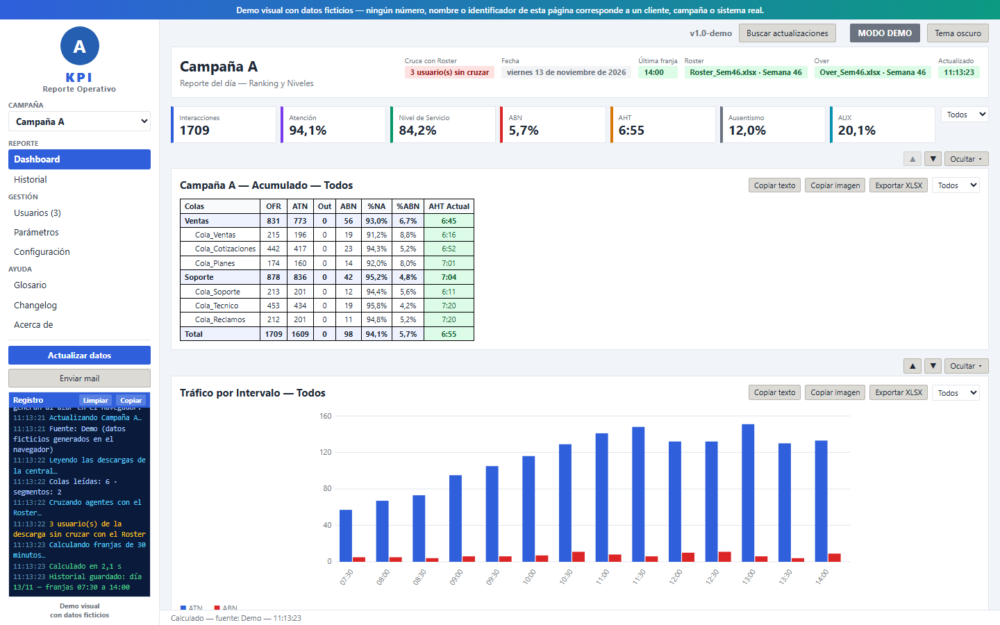
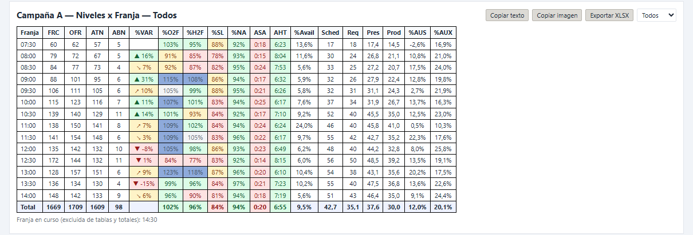
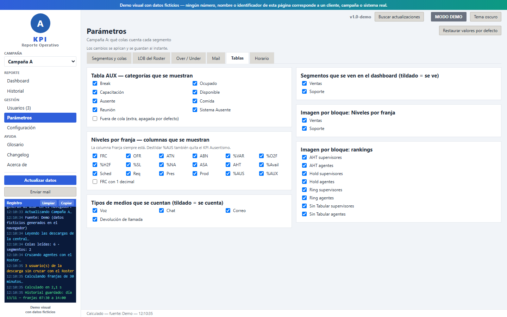
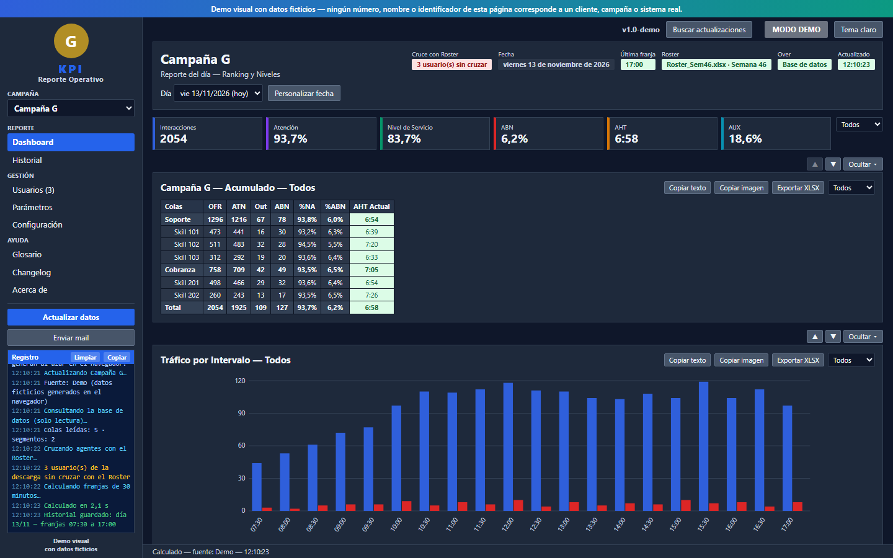
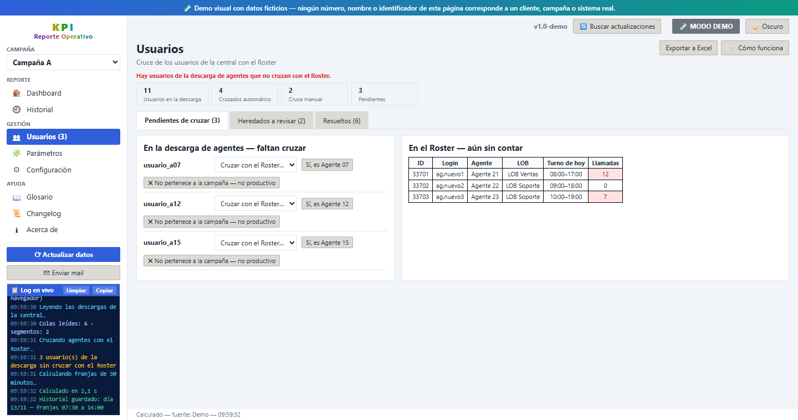

# Panel de reportes operativos para contact center — demo visual


> **Demo visual con datos ficticios.** Ningún número, nombre o identificador de este repositorio corresponde a un cliente, campaña o sistema real.

Maqueta navegable de un sistema de reportes operativos para contact center con varias campañas. Cada campaña tiene sus propios segmentos y su propia fuente de datos, y el panel calcula nivel de atención, nivel de servicio, abandono, tiempos de atención y dotación por franja de 30 minutos.

Es un único archivo HTML: no tiene dependencias, no necesita instalación y no se conecta a ningún servidor.

**[Ver la demo en vivo](https://agonzalez-97.github.io/contact-center-kpi-demo/)**



## Qué muestra

- **Ocho campañas ficticias (A a H)** con distinta configuración. Seis tienen una fuente tipo nube (archivos exportados) y dos una fuente tipo on-premise (consulta de solo lectura), con selector de día y calendario.
- **Dashboard** con fila de KPIs, chips de estado (cruce con el Roster, última franja, archivos de la semana) y nueve bloques que se pueden reordenar y ocultar: acumulado, tráfico por intervalo, niveles por franja, auxiliares, rankings por supervisor y por agente, motivos, interacciones por cola y tipificaciones.
- **Cuadros exclusivos** de algunas campañas, con filtros por segmento.
- **Parámetros** en siete pestañas que modifican el dashboard al instante: segmentos y colas, LOB del Roster, Over/Under, mail, tablas, horario y nombres de skills.
- **Configuración, Usuarios** (cruce manual y automático de usuarios contra el Roster), **Historial, Glosario, Changelog y Acerca de**.
- **Tema claro y oscuro**: cambian solo los colores neutros, los semáforos de datos se mantienen.









## Cómo ejecutarla

Abrir `index.html` en cualquier navegador moderno. Como alternativa, servirla en local:

```bash
python -m http.server 8000
# luego abrir http://localhost:8000
```

Parámetros opcionales en la URL, útiles para enlazar una vista concreta:

| Parámetro | Ejemplo | Efecto |
|---|---|---|
| `v` | `#v=parametros` | Vista inicial (`dashboard`, `historial`, `usuarios`, `parametros`, `config`, `glosario`, `changelog`, `acerca`) |
| `c` | `#c=G` | Campaña inicial (`A` a `H`) |
| `t` | `#v=parametros&t=tablas` | Pestaña dentro de Parámetros, Configuración o Usuarios |
| `th` | `#th=dark` | Tema (`light` o `dark`) |
| `seed` | `#seed=11` | Semilla fija para obtener siempre los mismos datos |

## Stack

HTML, CSS y JavaScript sin librerías ni paso de compilación. Los gráficos son SVG generados en el navegador.

## Contexto y método

Esta demo reproduce, con datos ficticios, el tipo de herramienta que desarrollé para un entorno laboral real (el código real es privado).

- **Problema.** Los reportes en Excel eran lentos y tenían discrepancias: las fórmulas no se actualizaban al agregar una línea de negocio, con varios días de datos Excel daba errores o se colgaba por falta de memoria, y cada cambio rompía una fórmula o la volvía más pesada. Además, operaciones necesitaba el reporte dentro de los 10 minutos de iniciada cada franja de 30 minutos.
- **Idea.** Mantener los archivos crudos que ya se usaban y procesarlos con otro motor (Python y Pandas) en lugar de fórmulas de Excel. Nació por iniciativa propia y se desarrolló con asistencia de IA.
- **Validación.** La lógica ya existía en el Excel: se tomó como referencia, se migró con ayuda de IA y se controló contra ese Excel. Cada KPI nuevo se agrega directamente al programa y se valida con operaciones y gerencia antes de mostrar un resultado final al cliente.
- **Resultado.** Tiempo promedio por campaña de unos 40 minutos a menos de 5 (cifras aproximadas, no un cronometraje formal), con entrega dentro de los 10 minutos de iniciada cada franja en todas las operaciones.

## Decisiones de diseño

- **Razón de sumas.** Todos los porcentajes se calculan como suma de numeradores sobre suma de denominadores, nunca como promedio de porcentajes. Lo mismo vale para las filas de total.
- **Semáforos por umbral.** Nivel de servicio, atención, cumplimiento del pronóstico, ASA y AHT usan umbrales fijos. La flecha de variación entre franjas usa los percentiles 25, 50 y 75 de la propia tabla.
- **Franjas cerradas.** Solo se muestran las franjas ya terminadas; la que está en curso se excluye de tablas y totales.
- **Parámetros con efecto real.** Mover una cola de segmento o ocultar una columna recalcula el dashboard. Los cambios se guardan en el navegador (`localStorage`) y se pueden restaurar a sus valores por defecto.
- **Datos reproducibles.** Los datos salen de un generador pseudoaleatorio con semilla, con curvas de volumen de dos picos por día.
- **Un panel roto no tumba al resto.** Cada bloque se dibuja de forma aislada y muestra un aviso si falla.

## Límites de la demo

Todo es simulado. Exportar, copiar imagen o texto y «Enviar mail» solo muestran un aviso: la página no descarga ni lee archivos, no abre correos y no hace ninguna petición de red.

## Autor y licencia

Hecho por Axel Hernán González. Licencia [MIT](LICENSE).
